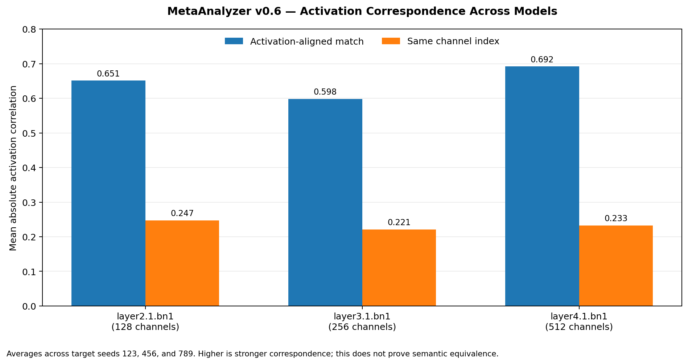
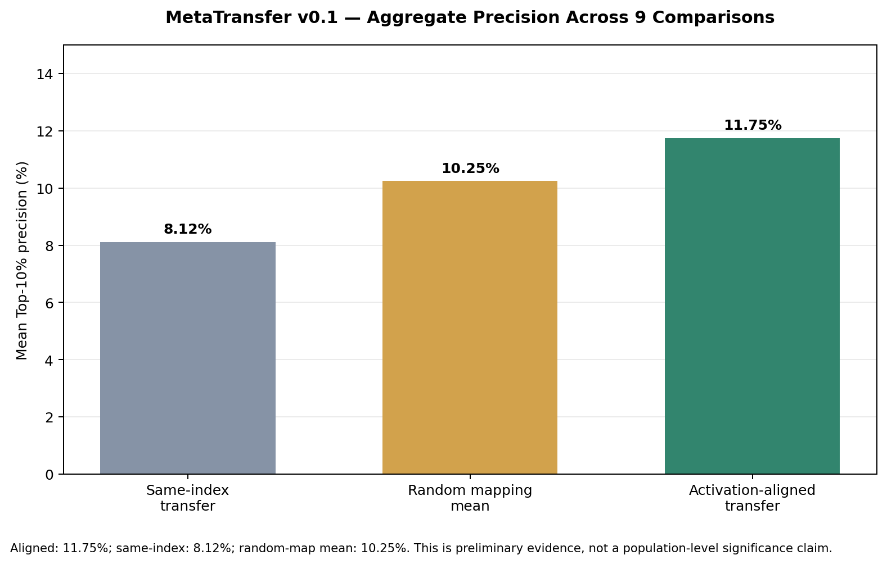
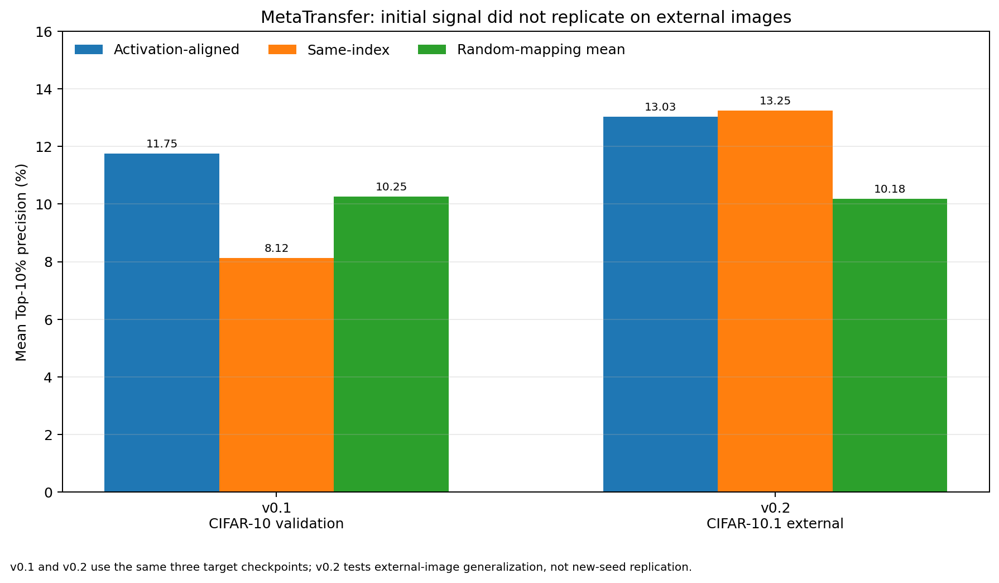
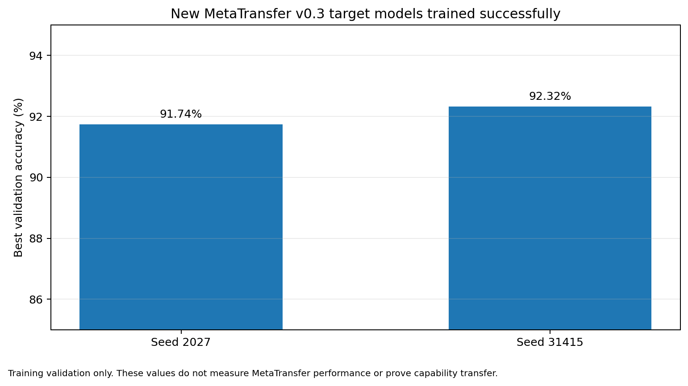
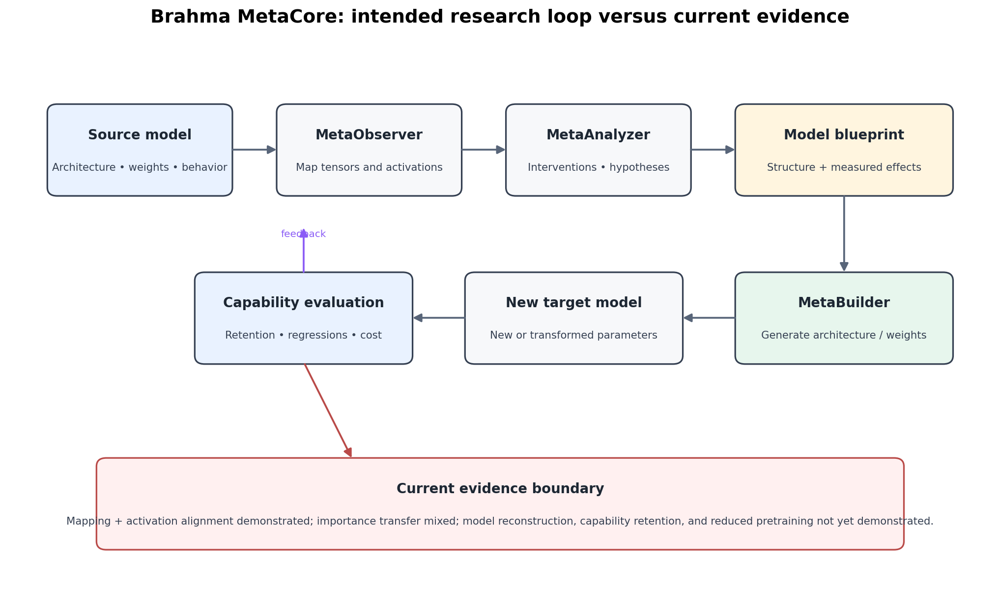
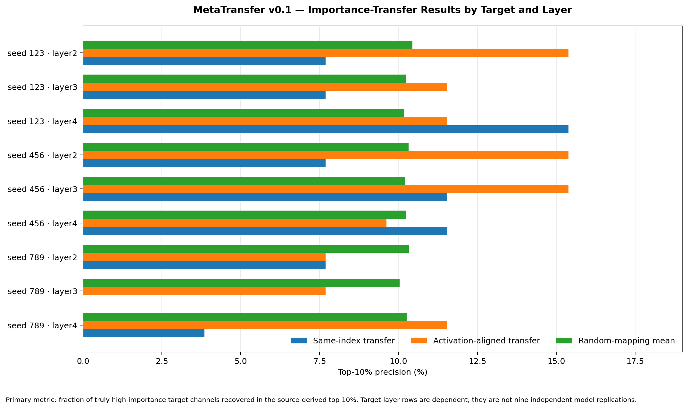
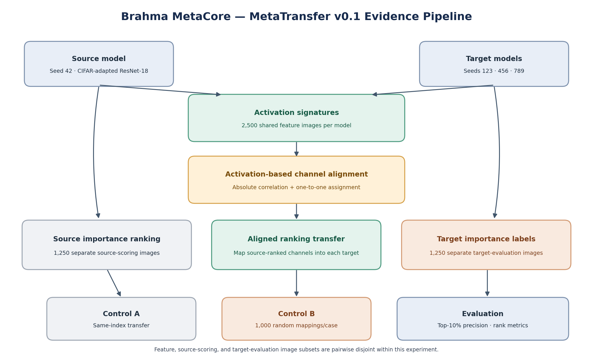
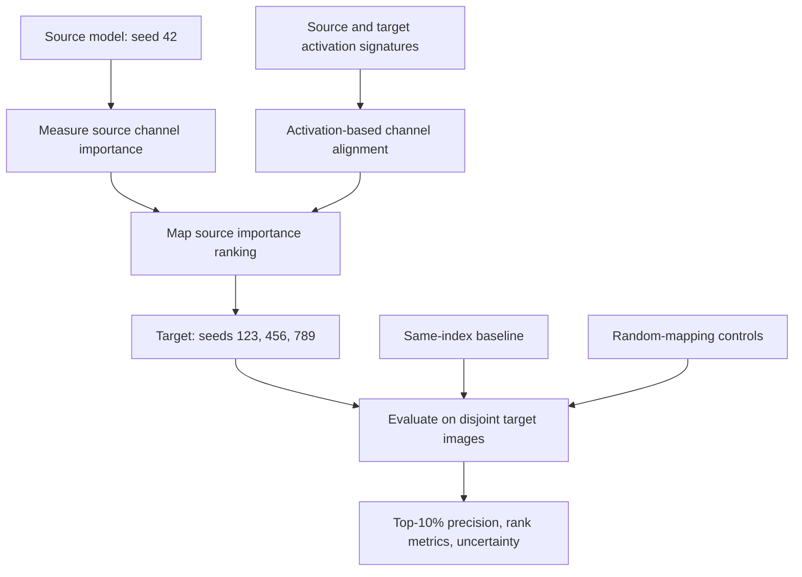

# Brahma MetaCore

## The Intelligence That Builds Intelligence

Brahma MetaCore is an experimental AI research project investigating whether information extracted from an existing AI model can help analyze, construct, transfer knowledge to, or modify another model.

The long-term goal is to develop a system that can **map a model, learn from its structure and behavior, and use that information to make better model-construction or model-editing decisions**. An eventual ambition is to discover reusable construction principles that reduce the data and computation needed to achieve useful capabilities.

These are research goals, not established capabilities. Each stage must be tested against controlled baselines, and conclusions must remain proportional to the evidence.

## Current Evidence Snapshot (16 October 2026)

Brahma MetaCore's long-term objective is to understand how model architecture, parameters, weights, and learned representations produce capabilities, then use that understanding to construct or modify another model. **The current experiments have not yet demonstrated model reconstruction or capability-preserving new-weight generation.**

### Evidence summary

| Claim / experiment | Evidence | Conclusion |
| --- | --- | --- |
| Activation-based channel alignment (v0.6/v0.7) | Mean absolute matched activation correlations: layer2 0.651 vs 0.247 same-index; layer3 0.598 vs 0.221; layer4 0.692 vs 0.233 | Strong correspondence signal in the tested ResNet-18/CIFAR-10 setup |
| Importance transfer (v0.1) | Mean Top-10% precision: aligned 11.75%, same-index 8.12%, random-map mean 10.25% | Initial positive signal, but inconsistent across layers and target seeds |
| External-image replication (v0.2, CIFAR-10.1 v6) | Aligned 13.03%, same-index 13.25%, random-map mean 10.18%; aligned beat same-index in 3/9 comparisons | The predefined directional success rule failed; importance-transfer advantage not replicated |
| New target training (v0.3 preparation) | Seed 2027: 91.74% best validation accuracy; seed 31415: 92.32% | New target checkpoints trained successfully; this is not evidence that transfer works |
| Model reconstruction / new-weight generation | Not yet tested | Core objective remains unproven |











### Evidence and failure boundary

- **Supported:** activation-signature matching finds more correlated channel patterns than same-index matching in the tested models.
- **Preliminary:** activation alignment can sometimes improve transfer of channel-importance rankings.
- **Negative / failed replication:** on CIFAR-10.1 v6, aligned Top-10% precision (13.03%) was slightly below same-index precision (13.25%), and the predefined directional rule failed.
- **Not tested yet:** constructing a new model from a model map; generating new weights that preserve capabilities; incorporating new data while retaining old capabilities; or reducing pretraining data/compute.

The v0.2 experiment used the same target checkpoints as v0.1, so it is an external-image evaluation, **not** independent-seed replication. The v0.3 target checkpoints with seeds 2027 and 31415 are new independently initialized models, but the v0.3 transfer evaluation has not yet been confirmed complete. The nine layer-level comparisons are dependent and must not be treated as nine independent model replications.

## Core Research Loop

1. **Map:** Inspect a model's architecture, parameters, weights, activations, and measurable behavior.

2. **Analyze:** Investigate how components affect behavior and identify potentially reusable structures or parameter relationships.

3. **Predict:** Estimate the effects of interventions or modifications before applying them.

4. **Construct or edit:** Use information from the map to initialize, transfer, modify, or design a target model.

5. **Evaluate:** Measure capabilities, retained performance, data requirements, compute cost, and regressions.

6. **Improve:** Use the measured outcomes to revise the mapping, analysis, and construction methods.

The central transition is from observing a model to using observations to make better decisions about another model.

## Research Objectives

1. **Neural-network mapping:** Inspect architectures, parameters, weights, activations, and computational relationships.

2. **Component analysis:** Investigate component contributions through controlled interventions.

3. **Predictive model understanding:** Predict intervention effects and test generalization to independently trained models.

4. **Representation alignment:** Find correspondences between internal activation patterns across models.

5. **Model construction:** Use information extracted from a source model to help initialize, transfer, or construct a target model.

6. **Model editing and knowledge integration:** Add information or task capabilities while measuring retention of existing capabilities.

7. **Parameter generation and modification:** Explore algorithms that generate, initialize, select, or modify useful parameters.

8. **Reduced training requirements:** Test whether model mapping and AI-assisted construction reduce data or compute requirements at comparable capability levels.

9. **Recursive model construction:** Investigate systems that analyze models, propose operations, evaluate outcomes, and improve their construction strategies.

---

## Experimental Setup

- **Task:** CIFAR-10 image classification.

- **Model family:** CIFAR-adapted ResNet-18.

- **Framework:** PyTorch and torchvision.

- **Hardware:** NVIDIA RTX 3050 Ti Laptop GPU, 4 GB VRAM.

- **Environment:** Windows, Python 3.12.10, PyTorch 2.5.1+cu121, torchvision 0.20.1+cu121.

- **Model size:** Approximately 11.17 million parameters.

- **Validation protocol:** The later training runs use 45,000 training examples and 5,000 validation examples from the CIFAR-10 training partition. The official CIFAR-10 test set was not loaded in v0.5-v0.7 or MetaTransfer v0.1. Earlier exploratory training and v0.3 did use it, so it is not treated as a pristine benchmark.

- **Reproducibility:** Experiments record seeds, checkpoints, split indices, configurations, and machine-readable JSON reports.

The hardware and software details describe the current experimental environment; results may differ on other systems.

## Experimental Progress

### 1. MetaObserver v0.1 — Neural-network inspection

**Status: Implemented and tested**

The inspection infrastructure supports:

- Model architecture and module inspection.

- Parameter counting and model metadata collection.

- Activation capture using hooks.

- Activation-statistic collection and structured reporting.

- Hook cleanup and automated tests.

The initial smoke test inspected an approximately 11.17-million-parameter ResNet-18 and captured activations from 52 modules. The smoke test used random weights, so it validated the instrumentation rather than learned capabilities.

### 2. Training and weight analysis

**Status: Completed for the current CIFAR-10 baseline**

An exploratory training run achieved a best observed test accuracy of **92.38% at epoch 19**. The official test set was evaluated repeatedly and used to select the best epoch, so this is not an unbiased final benchmark.

A later, cleaner protocol used 45,000 training examples and 5,000 validation examples and achieved **92.26% validation accuracy at epoch 20**.

A comparison of initial and trained parameters found changes across 102 state tensors and a relative global L2 parameter change of approximately 0.915. This confirms substantial parameter change during training; parameter change alone does not explain the learned mechanisms.

### 3. MetaAnalyzer v0.2 — Controlled channel interventions

**Status: Completed**

A channel-ablation pipeline evaluated **896 interventions** across three batch-normalization layers, using 5,000 validation examples and random-control channels. The full scan took approximately 35 minutes.

The experiments established a systematic way to measure changes in loss and accuracy after zeroing channel outputs. They did **not** establish a strong, consistent advantage for all selected candidate channels over controls. Selection bias must be considered when interpreting the strongest observed effects.

Channel-ablation sensitivity is not, by itself, proof that a channel represents a semantic concept or an independently identifiable capability.

### 4. MetaAnalyzer v0.3 — Frozen-channel confirmation

**Status: Completed; interpretation limited**

A follow-up evaluated 39 previously selected candidate and control channels on 10,000 CIFAR-10 test examples. The baseline achieved **91.53% accuracy**, with mean loss of approximately **0.2638**.

The layer-2 candidate group had a mean loss increase of approximately **0.00451**, compared with approximately **0.00170** for its controls. Layer-3 results were weaker, while layer-4 candidates showed a small positive mean loss change relative to controls.

These are descriptive results, not statistically conclusive evidence. The same test split had already been repeatedly evaluated during the earlier training experiment and used for model selection, so it was not an untouched confirmation set.

### 5. MetaAnalyzer v0.4 — Predicting intervention effects from model statistics

**Status: Completed; predictive advantage not demonstrated**

A Random Forest regressor predicted absolute channel-ablation loss changes from activation statistics, batch-normalization parameters, and incoming/outgoing weight norms. The dataset contained 896 channel records, with held-out channels evaluated within each layer.

| Layer | Random Forest Spearman | Best tested single-feature heuristic |
| --- | ---: | ---: |
| `layer2.1.bn1` | 0.497 | 0.611 — outgoing weight norm |
| `layer3.1.bn1` | 0.300 | 0.330 — activation magnitude |
| `layer4.1.bn1` | 0.475 | 0.501 — incoming weight norm |

The Random Forest did not outperform the best individual heuristic in any layer. Features and labels came from the same validation split, channels are not independent observations, and holding out channels does not establish generalization to new models. This was a predictive pilot, not a demonstration of generalizable model understanding.

### 6. MetaAnalyzer v0.5 — Cross-model importance prediction

**Status: Completed; initial generalization signal, no clear win over simple heuristics**

This experiment tested transfer from a seed-42 source model to an independently trained seed-123 target model.

- Feature extraction and intervention labels used separate subsets of 2,500 examples each from the saved validation partition.

- The source predictor was evaluated against measured target-model intervention effects; target labels were not used to fit the predictor.

- The experiment measured 896 channels in each of two models, for 1,792 interventions, taking approximately 35 minutes.

Key target-model results:

| Method | Spearman correlation | Top-20 precision |
| --- | ---: | ---: |
| Random Forest | 0.545 | 0.40 |
| Incoming weight norm | 0.550 | 0.35 |
| Outgoing weight norm | 0.524 | 0.35 |
| Activation mean absolute value | 0.479 | 0.35 |
| Activation standard deviation | 0.380 | 0.45 |

The Random Forest showed a positive cross-model rank correlation, but incoming weight norm had a slightly higher Spearman correlation and activation standard deviation had higher top-20 precision. Results differed by layer. This is preliminary evidence that some source-model statistics relate to target-model importance, not proof of a reliable general predictor.

### 7. MetaAnalyzer v0.6 — Activation-based channel alignment

**Status: Full experiment completed; alignment signal observed, importance-transfer benefit mixed**

#### Research question

Can activation signatures identify corresponding channels across independently trained models, and does that alignment improve transfer of channel-importance information compared with matching channels by index?

#### Protocol

- **Models:** Four CIFAR-10 ResNet-18 checkpoints trained with seeds 42, 123, 456, and 789.

- **Layers:** `layer2.1.bn1` (128 channels), `layer3.1.bn1` (256 channels), and `layer4.1.bn1` (512 channels).

- **Feature subset:** 2,500 validation examples used to collect per-image, spatially pooled activation signatures and model features.

- **Intervention subset:** A separate 2,500 validation examples used to measure the absolute loss change from zeroing each channel.

- **Interventions:** 896 channels per model, **3,584 total**.

- **Matching:** Absolute Pearson correlations between activation signatures, with Hungarian assignment to produce a one-to-one channel mapping.

- **Evaluation:** Compare source-model measured channel importance against target-model measured importance using same-index and activation-aligned correspondence, with random-ranking references.

- **Official CIFAR-10 test set:** Not loaded during this experiment.

- **Runtime:** 4,288.2 seconds, approximately 71.5 minutes.

- **Report:** `reports/milestone2_v06/channel_alignment.json`

- **Caches:** `reports/milestone2_v06/cache/`

#### Baseline measurements on the intervention subset

| Seed | Accuracy | Loss |
| --- | ---: | ---: |
| 42 (source) | 92.00% | 0.245267 |
| 123 | 92.20% | 0.267273 |
| 456 | 91.56% | 0.262167 |
| 789 | 92.40% | 0.255667 |

These are measurements on the 2,500-example intervention subset, not official test-set benchmarks.

#### Finding A: activation matching improves activation correspondence

Mean absolute matched activation correlation, averaged across the three target seeds:

| Layer | Activation-matched correlation | Same-index correlation |
| --- | ---: | ---: |
| `layer2.1.bn1` | 0.651 | 0.247 |
| `layer3.1.bn1` | 0.598 | 0.221 |
| `layer4.1.bn1` | 0.692 | 0.233 |

Matched correlations were substantially higher than same-index correlations. Fewer than 1.6% of matched channels retained the same index in any reported target-layer comparison.

**Supported conclusion:** For these models and activation signatures, activation-based matching finds more correlated channel patterns than same-index matching. This does not prove that matched channels have identical semantic functions.

#### Finding B: importance transfer is mixed

Top-20 precision for predicting the target model's 20 most important channels from source-model measured importance:

| Target seed | Layer | Same-index precision | Aligned precision | Random expectation |
| --- | --- | ---: | ---: | ---: |
| 123 | Layer 2 | 0.15 | 0.25 | 0.156 |
| 123 | Layer 3 | 0.00 | 0.10 | 0.078 |
| 123 | Layer 4 | 0.10 | 0.05 | 0.039 |
| 456 | Layer 2 | 0.20 | 0.25 | 0.156 |
| 456 | Layer 3 | 0.10 | 0.20 | 0.078 |
| 456 | Layer 4 | 0.05 | 0.00 | 0.039 |
| 789 | Layer 2 | 0.20 | 0.30 | 0.156 |
| 789 | Layer 3 | 0.00 | 0.05 | 0.078 |
| 789 | Layer 4 | 0.05 | 0.20 | 0.039 |

Aligned top-20 precision was higher in **7 of 9 comparisons**, but some aligned results were below the random expectation, and improvements varied by layer and seed. Spearman correlations were generally weak. These descriptive results do not establish statistical significance or consistent importance-transfer improvement.

#### v0.6 limitations

- One dataset and one architecture family were tested.

- There are three target seeds and one source seed in this experiment.

- Channel observations within a model are correlated; they must not be treated as independent experimental replications.

- The activation mapping is derived from a finite feature subset and needs stability testing across subsets.

- The source scores are measured intervention effects, not a learned general-purpose importance predictor.

- The experiment evaluates importance correspondence, not an actual parameter-transfer, knowledge-transfer, or model-construction operation.

- No claim about general intelligence, semantic understanding, or reduced pretraining is supported by this experiment.

#### Overall v0.6 conclusion

The experiment provides a useful signal for **cross-model representation alignment**. Whether that signal yields a reliable practical advantage for transferring importance information remains unresolved. A controlled experiment that uses the alignment to modify a target model is needed to establish practical value.

---

## 8. MetaAnalyzer v0.7 — Robust Validation of Alignment

**Status: Completed; alignment robustness supported, importance-transfer benefit mixed.**

v0.7 reanalyzed v0.6 results using repeated subsets, randomized mappings, and channel-level bootstrap diagnostics. It compared nine target-layer cases (three target seeds × three layers).

| Layer | Mean matched-minus-same-index absolute activation correlation | Importance Spearman improved | Top-k precision improved |
| --- | ---: | ---: | ---: |
| `layer2.1.bn1` | +0.4043 | 1/3 target seeds | 3/3 target seeds |
| `layer3.1.bn1` | +0.3763 | 2/3 target seeds | 3/3 target seeds |
| `layer4.1.bn1` | +0.4591 | 1/3 target seeds | 1/3 target seeds |

The alignment consistently increased activation correspondence in all nine comparisons. The effects on importance prediction were inconsistent. Mapping agreement also improved as more feature examples were included: median stability was approximately 78.9% at 1,250 examples and 85.8% at 1,875 examples, measured as subset consistency on the existing feature set.

Bootstrap and random-mapping analyses were diagnostic rather than definitive population-level significance tests. The three target seeds are the principal replication units; the nine layer comparisons are not independent.

## 9. MetaTransfer v0.1 — Disjoint Channel-Importance Transfer

**Status: Completed; preliminary directional evidence, not a reliable general transfer claim.**

### Research question

Does source-to-target channel alignment help use a source model's measured channel-importance ranking to find important channels in another independently trained model?

### Protocol

- **Source:** CIFAR-adapted ResNet-18, seed 42.
- **Targets:** independently trained checkpoints with seeds 123, 456 and 789.
- **Layers:** `layer2.1.bn1` (128 channels), `layer3.1.bn1` (256 channels), and `layer4.1.bn1` (512 channels).
- **Feature signatures:** 2,500 validation images/model, reused from v0.6.
- **Source importance ranking:** 1,250 images, measured by single-channel ablation on source seed 42.
- **Target evaluation:** a separate 1,250 images, with channel effects recomputed for each target. Feature, source-scoring and target-evaluation subsets were pairwise disjoint.
- **Controls:** same-index transfer and 1,000 random mappings per target-layer comparison.
- **Total new ablations:** 3,584 (896 for each of four models).
- **Runtime:** 2,008.8 seconds (approximately 33.5 minutes).
- **Official CIFAR-10 test set:** not loaded.
- **Reports:** `reports/metatransfer_v01/transfer_report.json` and `reports/metatransfer_v01/transfer_report.md`.

### Primary result — Top-10% precision

Top-10% precision measures how many of the target's genuinely most important channels are recovered by transferring the source ranking. Results are averaged over nine target-layer comparisons.

| Method | Mean Top-10% precision |
| --- | ---: |
| Same-index transfer | 8.12% |
| Random-mapping control mean | 10.25% |
| Activation-aligned transfer | **11.75%** |

Aligned transfer improved mean precision by **3.63 percentage points** over same-index transfer and **1.50 percentage points** over the random-mapping mean. It beat same-index transfer in 6/9 comparisons, tied once, and beat the random-mapping mean in 6/9 comparisons. All three target seeds had a positive layer-averaged difference versus same-index transfer; however, the average aligned precision for seed 789 remained below its random-mapping mean.



### Layer-by-layer primary results

| Target | Layer | Same-index P@10% | Aligned P@10% | Random-map mean P@10% |
| --- | --- | ---: | ---: | ---: |
| seed 123 | `layer2.1.bn1` | 7.69% | **15.38%** | 10.45% |
| seed 123 | `layer3.1.bn1` | 7.69% | **11.54%** | 10.25% |
| seed 123 | `layer4.1.bn1` | **15.38%** | 11.54% | 10.17% |
| seed 456 | `layer2.1.bn1` | 7.69% | **15.38%** | 10.32% |
| seed 456 | `layer3.1.bn1` | 11.54% | **15.38%** | 10.21% |
| seed 456 | `layer4.1.bn1` | **11.54%** | 9.62% | 10.24% |
| seed 789 | `layer2.1.bn1` | 7.69% | 7.69% | 10.33% |
| seed 789 | `layer3.1.bn1` | 0.00% | 7.69% | 10.03% |
| seed 789 | `layer4.1.bn1` | 3.85% | **11.54%** | 10.26% |

### Interpretation

This is **preliminary evidence that activation alignment can help transfer channel-importance rankings**, relative to same-index transfer. It is not strong evidence that aligned transfer consistently beats chance: individual randomized mappings often perform similarly, gains vary by layer, and randomization reference probabilities are not stand-alone population significance tests. Signed-effect transfer is a secondary exploratory metric and was weak/inconsistent; near-zero ablation effects can have unstable signs.

The validation partition was previously used for checkpoint selection in the project, so the evaluation subset is disjoint within this experiment but is not a pristine external benchmark. Results are limited to one task and one architecture family, with three target checkpoints. Single-channel ablation does not capture interactions among channels.

### Research-flow diagram

The current pipeline transfers an importance **ranking** for evaluation; it does not copy source weights or modify target parameters.





### What this milestone does and does not establish

**Supported within this setup:** activation-based matching finds more-correlated channel patterns than same-index matching, and the matched ranking produced a modest mean improvement over same-index channel-importance transfer.

**Not established:** consistent superiority over random mappings; semantic equivalence of matched channels; causal understanding of whole-network function; useful weight/parameter transfer; automatic architecture construction; adding knowledge while retaining capabilities; or reduced training data/compute requirements.

## MetaTransfer v0.3 — Independent-seed replication (16 October 2026)

**Status: Completed.** The audit passed, the full evaluator completed in 1,468 seconds (approximately 24.5 minutes), and both JSON and Markdown reports were created at `reports/metatransfer_v03_new_seeds/`.

### Protocol

- **Frozen source:** seed-42 importance rankings from v0.1.
- **New targets:** independently initialized ResNet-18 models with seeds 2027 and 31415, each trained for 20 epochs on the frozen project split.
- **Evaluation images:** 2,000 CIFAR-10.1 v6 external images per target; external labels were not used to derive the channel mappings.
- **Layers:** layer2.1.bn1 (128 channels), layer3.1.bn1 (256), layer4.1.bn1 (512).
- **Interventions:** 896 channel ablations per target, 1,792 across the two new targets.
- **Baseline accuracy on CIFAR-10.1 v6:** seed 2027 = 83.70%; seed 31415 = 84.10%.
- **Official CIFAR-10 test set:** not loaded.
- **Outputs:** `reports/metatransfer_v03_new_seeds/transfer_report.json` and `transfer_report.md`.

### Top-10% precision by target and layer

| Target | Layer | Same-index | Activation-aligned | Random-mapping mean |
|---|---|---:|---:|---:|
| seed 2027 | layer2.1.bn1 | 7.69% | 15.38% | 10.0% |
| seed 2027 | layer3.1.bn1 | 11.54% | 11.54% | 10.4% |
| seed 2027 | layer4.1.bn1 | 19.23% | 11.54% | 10.1% |
| seed 31415 | layer2.1.bn1 | 0.00% | 23.08% | 10.2% |
| seed 31415 | layer3.1.bn1 | 11.54% | 11.54% | 10.3% |
| seed 31415 | layer4.1.bn1 | 3.85% | 21.15% | 10.2% |


### Aggregate descriptive summary

Across the six target-layer comparisons:

| Method | Mean Top-10% precision |
|---|---:|
| Same-index | 8.95% |
| Activation-aligned | 15.70% |
| Random-mapping mean | approximately 10.20% |

Aligned transfer beat same-index in **3 of 6** comparisons, tied in **2 of 6**, and lost in **1 of 6**. It exceeded the reported random-mapping mean in all six rows. The layer-averaged results were equal for seed 2027 (12.8% aligned and 12.8% same-index) and favored alignment for seed 31415 (18.6% aligned versus 5.1% same-index).

### Interpretation

This is a **promising but very small independent-seed replication** for channel-importance ranking transfer. It improves on the v0.2 external-image result in that the target models are genuinely new seeds. However, there are only two new target models; results differ by layer and target. Six layer rows are nested within two models and are not six independent replications. Random-mapping means are permutation references, not population-level significance tests. The values above do not establish statistical significance, general transfer across architectures, or practical parameter/knowledge transfer.

The result supports continuing to investigate the method, but it does not justify making channel alignment the central objective of Brahma MetaCore.

### Research decision

The immediate validation milestone is complete. Preserve v0.1/v0.2/v0.3 reports unchanged. The next main experiment should move closer to MetaCore's central goal:

1. Select a small, controlled model and define a capability evaluation suite.
2. Map its architecture, parameter tensors, activations, and baseline behavior.
3. Apply predefined parameter/component interventions and measure behavioral effects.
4. Test whether those measurements predict interventions on held-out inputs and independent seeds.
5. Attempt a first reconstruction or MetaCore-guided initialization, comparing against direct copying (where applicable), random initialization, and conventional training under a matched budget.
6. Report capability retention, data/compute cost, and regressions. Do not claim reduced pretraining unless the controlled baseline demonstrates it.

## Current Research Status (updated 16 October 2026)

**Current stage: model observation, intervention analysis, robust activation alignment, and preliminary importance transfer.**

### Established within the current experimental setup

- A working neural-network inspection and activation-capture pipeline, with automated tests.
- A reproducible CIFAR-10 training and validation workflow.
- A systematic single-channel ablation method across 896 channels in three ResNet-18 layers.
- Initial tests of predictors for channel-ablation effects; the tested Random Forest did not beat the best single-feature heuristic in the v0.4 pilot.
- Cross-model importance prediction tests on independently trained checkpoints, with no reliable advantage over simple heuristics demonstrated in v0.5.
- Activation-based channel alignment across four independently trained CIFAR-adapted ResNet-18 checkpoints.
- v0.7 validation showing stronger matched activation correlation than same-index correspondence across all nine target-layer cases.
- MetaTransfer v0.1 showing mean Top-10% precision of 11.75% for aligned ranking transfer, compared with 8.12% for same-index transfer and 10.25% for the random-mapping mean.

### Not yet demonstrated

- Consistent superiority of channel-importance transfer over random mappings or statistically reliable improvement across a larger number of independent target models.
- Generalization across architectures and datasets.
- A practical improvement from MetaCore-guided parameter transfer or actual target-model modification.
- Construction of a useful target model from a model map.
- Reliable addition of information or capabilities while preserving prior performance.
- Reduced data or compute requirements relative to conventional baselines.
- Recursive improvement of the model-construction process.

## Current Milestone: MetaTransfer v0.3 — Independent-Seed Replication

**Status as of 16 October 2026: two new target models trained and verified; transfer evaluator created and syntax-checked; local audit and full evaluation still pending.**

Two new CIFAR-adapted ResNet-18 targets were trained on the same frozen 45,000/5,000 split with independent initialization/shuffle seeds:

| Target seed | Best validation accuracy | Training status |
| --- | ---: | --- |
| 2027 | 91.74% | Complete; 20 epochs recorded |
| 31415 | 92.32% | Complete; 20 epochs recorded |


These accuracy values are training-quality checks only. They do not establish any benefit from MetaTransfer.

### Evaluation procedure

1. Run the evaluator's audit-only mode and inspect the output before running the full experiment.
2. Freeze source seed-42 importance rankings and the transfer method; compute fresh activation mappings for each new target.
3. Evaluate target channel effects on CIFAR-10.1 v6 images, without using external labels to derive the channel mapping.
4. Compare activation-aligned transfer against same-index and random-mapping controls.
5. Summarize results at the **target-seed level**, with layer-wise detail treated as nested/dependent evidence.
6. Preserve the v0.1/v0.2 reports and all prior checkpoints. Write only to the new versioned output directory.

The v0.3 script is available separately as `run_metatransfer_v03.py`. It has only been syntax-checked in the preparation environment; it has not been verified against the local project runtime. Run `--audit-only` first. Do not interpret a successful audit as a successful transfer result.

### Decision rule

A favorable result would be evidence for a narrow importance-transfer method only. It would not demonstrate model reconstruction, general understanding, or reduced pretraining. If the independent-seed results are mixed or negative, record that and move the central research effort toward direct parameter intervention and reconstruction rather than repeatedly tuning channel matching.

## The Core Objective: Understand and Construct Models

The project must not confuse its current channel-alignment experiments with the ultimate goal. Brahma MetaCore is intended to study relationships between a model's architecture, parameters, weights, internal activations, training data, and observable capabilities, then use the resulting map to make and test model-construction decisions.

The intended progression is:

1. **Observe:** capture architecture, tensor shapes, parameter values/statistics, activations, and baseline behavior.
2. **Intervene:** modify selected weights, activations, or components and measure effects on defined tasks.
3. **Explain and predict:** build testable hypotheses about which changes cause which outcomes; verify predictions on held-out inputs and independent model seeds.
4. **Construct:** generate a target architecture and/or new or transformed weights from the model map.
5. **Measure capability retention:** compare source and target behavior on a predeclared evaluation suite.
6. **Add information:** incorporate new data or tasks and measure new capability, old-capability retention, and regressions.
7. **Measure efficiency:** compare data, compute, time, and final capability against conventional baselines.

A model map may include useful information about architecture and parameter effects, but it should not be assumed to contain enough information to reconstruct all learned knowledge. That is a central experimental question.

## Longer-Term Research Phases

### Phase 1 — Map and predict model behavior

**Status: In progress.**

Inspect architectures, compare initial and trained parameters, trace activations, perform interventions, align representations, and validate predictions across independently trained models.

### Phase 2 — Transfer information and construct a target model

**Status: Planned; not demonstrated.**

MetaTransfer v0.1 tests transfer of channel-importance rankings only. Actual target initialization, component/parameter transfer, or model construction remains future work and must be compared with conventional methods under matched conditions.

### Phase 3 — Edit models to add information or capabilities

**Status: Future research.**

Investigate adding new task capabilities or information while retaining prior performance. Evaluate new-task performance, retention, regressions, and compute/data costs.

### Phase 4 — Recursive model construction

**Status: Future research.**

Investigate systems that map models, propose construction or editing operations, evaluate targets, and improve their strategies from measured outcomes. This depends on earlier stages becoming reliable.

## Research Evaluation Principles

All major claims should be tested using controlled experiments.

- **Predictive validity:** Can the system forecast measurable outcomes before intervention or training?

- **Generalization:** Do findings hold across new checkpoints, random initializations, datasets, and architectures?

- **Causal evidence:** Do controlled interventions support claims about component contributions?

- **Alignment validity:** Is the mapping stable, and does it improve downstream outcomes over appropriate controls?

- **Construction benefit:** Does MetaCore-guided construction outperform conventional baselines?

- **Knowledge retention:** When editing a model, does it gain the intended capability without unacceptable loss of existing capabilities?

- **Training efficiency:** Does the approach reduce data or compute while preserving or improving target performance?

- **Statistical reliability:** Are results reproducible, with uncertainty and limitations reported?

- **Independent verification:** Can other researchers reproduce the experiments?

## Reproducibility

Experiments should record:

- Model architecture and parameter count.

- Dataset, preprocessing, and data-split details.

- Random seeds and experiment configurations.

- Training procedures and optimization settings.

- Evaluation metrics and intervention or editing results.

- Software versions, hardware, and CUDA environment.

- Model checkpoints and machine-readable experiment reports.

The project uses PyTorch and torchvision. Machine-readable reports and cached experiment outputs should be versioned by milestone; do not overwrite earlier results when running new experiments.

## Guiding Principle

**Understand how model structure and parameters produce measured capabilities. Use that evidence to construct or modify another model, then test whether capability is retained and training cost is reduced.**

Brahma MetaCore investigates whether information extracted from existing AI models can become a practical resource for building and modifying future models—not merely analyzing or training them.

The main evidence figures in `assets/` are generated from the machine-readable v0.6 and MetaTransfer v0.1 reports. They visualize the measured correlation and precision values in this document; they are not independent experiments.

The ambition is broad; the evidence must be earned one experiment at a time.


## Reproducible Status Ledger (16 October 2026)

| Artifact / result | Status | Interpretation |
| --- | --- | --- |
| `reports/milestone2_v06/channel_alignment.json` | Completed | Alignment evidence |
| `reports/milestone2_v07/validation_report.json` | Completed | Robustness diagnostics; not a population-level significance test |
| `reports/metatransfer_v01/transfer_report.json` | Completed | Initial importance-transfer signal |
| `reports/metatransfer_v02_external_run2` and `.md` | Completed | External-image directional rule failed |
| `checkpoints/metatransfer_v03_seed2027` | Completed | New target model, seed 2027 |
| `checkpoints/metatransfer_v03_seed31415` | Completed | New target model, seed 31415 |
| `src/experiments/run_metatransfer_v03.py` | Prepared; local audit pending | Syntax-checked only; do not claim evaluation success yet |

### Next local commands

From the project root in the activated Python environment:

```powershell
python -m py_compile src\experiments\run_metatransfer_v03.py
python -m src.experiments.run_metatransfer_v03 --audit-only
```

Inspect the complete audit output. If it reports errors, stop and fix those before the full evaluation. If the audit passes, run:

```powershell
python -m src.experiments.run_metatransfer_v03
```

Do not overwrite previous report directories or checkpoints. After the result is generated, update this README with the measured output—including negative results—before deciding the next experiment.
